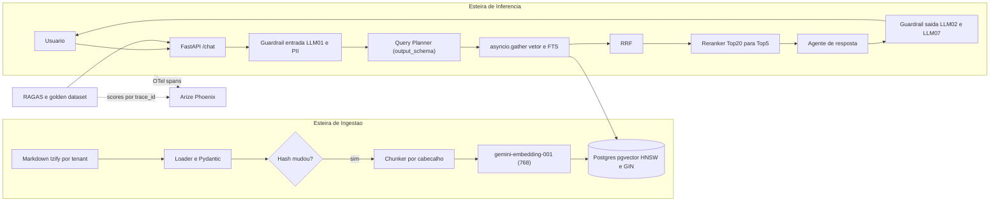

# Projeto Izify RAG: Python + Google ADK + pgvector + RAGAS + OWASP

## Ponto de partida e decisões

- O workspace está vazio. Só existe o `[.env](.env)`, que tem `GEMINI_API_KEY`. O Python 3.13 e o Docker estão instalados, mas faltam o `uv` e o `gcloud`.
- Provedor de modelos: nas Fases 1 a 4, usar a Gemini API (AI Studio) via `google-genai`. Na Fase 5, migrar para o Vertex AI trocando apenas variáveis de ambiente (`GOOGLE_GENAI_USE_VERTEXAI=true`).
- Embeddings: usar o `gemini-embedding-001` com `output_dimensionality=768`, para manter a coluna `vector(768)`. O `text-embedding-004` está sendo descontinuado no AI Studio.
- Observabilidade: Arize Phoenix em um único container, recebendo OTLP, com `openinference-instrumentation-google-adk`.
- Reranker: interface plugável. A implementação padrão é local (cross-encoder `BAAI/bge-reranker-v2-m3`, sem custo nem chave nova). A Vertex AI Ranking API entra na Fase 5.
- Stack: `uv`, Pydantic v2, `pydantic-settings`, SQLAlchemy 2.0 async + `psycopg[binary]` 3, Alembic, Typer (CLI), FastAPI, `google-adk`, `ragas`, `pytest` e `pytest-asyncio`.

## Arquitetura



## Estrutura do repositório

```
pyproject.toml / uv.lock / docker-compose.yml / .env.example / alembic/
src/izify/
  config.py                 # pydantic-settings (lê o .env)
  db/        engine.py, models.py, tenant.py (SET LOCAL app.tenant_id)
  ingestion/ loaders.py, chunker.py, embedder.py, pipeline.py, cli.py
  retrieval/ vector.py, fulltext.py, hybrid.py (RRF), reranker.py
  agents/    tools.py, support_agent.py, planner.py, root.py, callbacks.py
  guardrails/ injection.py, pii.py, output.py
  observability/ tracing.py
  api/       main.py, schemas.py
data/docs/{tenant_slug}/*.md   # manuais, SLA, troubleshooting, FAQ fictícios do Izify
evals/     golden_dataset_izify.json, run_ragas.py
tests/     unit/, integration/, security/
.github/workflows/ci.yml
```

## Fase 1: fundação de dados e ingestão vetorial

- Instalar o `uv` (`brew install uv`), rodar `uv init` com Python 3.13 e configurar `ruff` e `mypy`.
- `docker-compose.yml` com `pgvector/pgvector:pg17` e um script de init que cria a extensão `vector` e dois papéis: `izify_ingest` (escrita) e `izify_agent_ro` (somente leitura).
- Migração no Alembic:

```sql
CREATE TABLE documents (
  id uuid PRIMARY KEY, tenant_id uuid NOT NULL, source_path text NOT NULL,
  doc_type text NOT NULL, content_hash char(64) NOT NULL, metadata jsonb NOT NULL DEFAULT '{}',
  updated_at timestamptz NOT NULL DEFAULT now(), UNIQUE (tenant_id, source_path));
CREATE TABLE document_chunks (
  id uuid PRIMARY KEY, document_id uuid REFERENCES documents ON DELETE CASCADE,
  tenant_id uuid NOT NULL, chunk_index int NOT NULL, heading_path text, content text NOT NULL,
  embedding vector(768) NOT NULL,
  fts tsvector GENERATED ALWAYS AS (to_tsvector('portuguese', content)) STORED);
CREATE INDEX ON document_chunks USING hnsw (embedding vector_cosine_ops);
CREATE INDEX ON document_chunks USING gin (fts);
CREATE INDEX ON document_chunks (tenant_id);
```

- Chunker: divide o Markdown por hierarquia de cabeçalhos, mantém blocos de código inteiros, guarda o `heading_path` e define o tamanho do chunk em tokens (parâmetro `--chunk-size` para o experimento da Fase 4).
- Pipeline idempotente: compara o `sha256` do arquivo com o `content_hash` salvo e só regera os embeddings quando o conteúdo mudou. Os embeddings saem em lote, com retry e backoff. CLI: `uv run izify ingest data/docs --tenant <slug>`.
- Criar o corpus fictício com 2 ou 3 tenants (por exemplo, uma hamburgueria e um restaurante árabe), incluindo o webhook da Evolution API, a política de SLA, o troubleshooting de cardápio agendado e o FAQ.
- Testes: chunker (código preservado), idempotência (a segunda execução gera 0 embeddings) e uma busca de similaridade de ponta a ponta.

## Fase 2: agente base com ADK e tracing

- `agents/tools.py`: a `search_knowledge_base(query: str, top_k: int)` usa args validados por Pydantic e é tipada para virar `FunctionTool`. O `tenant_id` vem do `tool_context.state` (preenchido pela API), nunca de um argumento escolhido pelo LLM.
- `agents/support_agent.py`: `LlmAgent` com `gemini-2.5-flash`, que cita as fontes (`source_path`, `heading_path`).
- `api/main.py`: `POST /chat` (`tenant_id` vem de um header fictício de autenticação, `session_id` e `message`) chama o `Runner`. O `InMemorySessionService` vira `DatabaseSessionService` no mesmo Postgres (`postgresql+asyncpg`).
- `observability/tracing.py`: `phoenix.otel.register(...)` + `GoogleADKInstrumentor`. Também cria spans manuais para a query SQL (`retrieval.vector`) e registra `tenant_id` e `session_id` como atributos. O Phoenix sobe no compose (`arizephoenix/phoenix`, porta 6006).
- Caso de Uso 1 validado: a pergunta sobre o webhook da Evolution API responde com a fonte, e o trace mostra os spans do ADK, do SQL e os tokens.

## Fase 3: Query Planner, busca híbrida e reranking

- `agents/planner.py`: `LlmAgent` com `output_schema=QueryPlan` (`rewritten_question`, `sub_queries: list[SubQuery]`, `route: Literal["vector","sql","tool"]`) e `output_key="plan"`.
- `agents/root.py`: um `SequentialAgent` que roda o planner, depois um `BaseAgent` custom de recuperação (determinístico, sem LLM) e por fim o agente de resposta, que lê o `state["context"]`.
- `retrieval/hybrid.py`: para cada sub-query, roda `asyncio.gather` da busca vetorial (Top-20) com o FTS `websearch_to_tsquery('portuguese', ...)` (Top-20). Depois faz o RRF (k=60) e a deduplicação.
- `retrieval/reranker.py`: `Protocol Reranker` com `CrossEncoderReranker` (padrão) e `VertexRankingReranker` (Fase 5). O Top-5 final vai para o agente.
- Rota `sql`: uma tool read-only para uma tabela relacional `menu_schedules`, que serve para diagnosticar o cardápio agendado da sexta às 20h.
- Caso de Uso 2 validado: o trace mostra 2 sub-queries, cerca de 25 candidatos e os 5 escolhidos pelo reranker.

## Fase 4: avaliação com RAGAS

- `evals/golden_dataset_izify.json`: 30 itens no formato `question`, `ground_truth`, `tenant` e `expected_sources`.
- `evals/run_ragas.py`: roda o pipeline (in-process, via `Runner`), coleta `answer`, `contexts` e `trace_id` e calcula Context Precision, Context Recall, Faithfulness e Answer Relevancy, com o Gemini como juiz e o mesmo modelo de embeddings.
- Envia os scores para o Phoenix como anotações por `trace_id` e salva `evals/reports/<timestamp>.json` para comparar execuções (chunk de 500 contra 1000, troca de modelo).
- `pytest -m eval`, com thresholds configuráveis (por exemplo, `faithfulness >= 0.85`). Os testes unitários usam mocks do LLM para não gastar créditos.
- `.github/workflows/ci.yml`: lint, testes unitários e um job de eval manual (`workflow_dispatch`).

## Fase 5: hardening OWASP e GCP

- LLM01: `guardrails/injection.py` usa regras determinísticas (padrões como "ignore as instruções" e "você agora é") mais um classificador barato (`gemini-2.5-flash-lite` com saída estruturada). Fica no `before_model_callback` e devolve uma `LlmResponse` de recusa. Também sanitiza os chunks recuperados para tratar injeção indireta vinda dos documentos.
- LLM06 e multi-tenant: RLS em `documents` e `document_chunks` (`USING (tenant_id = current_setting('app.tenant_id')::uuid)`). A sessão do agente roda como `izify_agent_ro` e faz `SET LOCAL app.tenant_id` em toda transação. O `before_tool_callback` rejeita a chamada se o args ou o state não tiverem o tenant esperado.
- LLM08: as tools só recebem a engine read-only, e não existe nenhuma tool de escrita ou SQL livre.
- LLM02 e LLM07: o `after_model_callback` bloqueia trechos do system prompt, links fora da allowlist e blocos executáveis.
- PII: `guardrails/pii.py` mascara CPF, telefone e e-mail na entrada e nos atributos de span. Na nuvem, a opção é a Sensitive Data Protection API.
- `tests/security/`: o ataque do Caso de Uso 4, um teste de vazamento entre tenants e documentos contaminados.
- GCP: Dockerfile multi-stage com `uv`, Cloud Run, Cloud SQL Postgres com pgvector, Secret Manager, Vertex AI (Gemini, embeddings e Ranking API) e opção de exportar os traces para o Cloud Trace. A IaC fica descrita como próximo passo (Terraform opcional).

## Ligação com a certificação (anotações por fase)

Cada fase termina com uma nota curta em `docs/gcp-mapping.md` que relaciona a peça local ao equivalente cobrado na prova:
- O script de ingestão corresponde a Dataflow, Pub/Sub e AlloyDB ou BigQuery Vector Search.
- Os relatórios do RAGAS correspondem a BigQuery e Looker Studio.
- O filtro de PII corresponde ao DLP.
- O agendamento da reindexação corresponde ao Cloud Composer.
